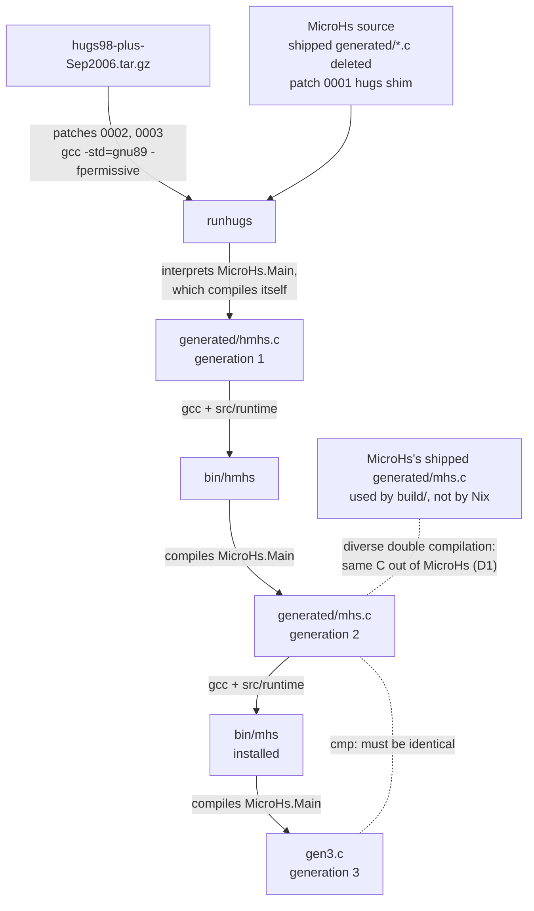
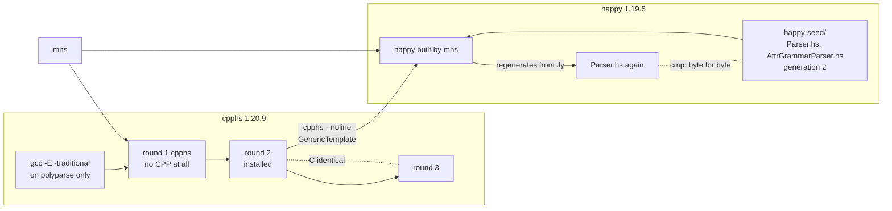
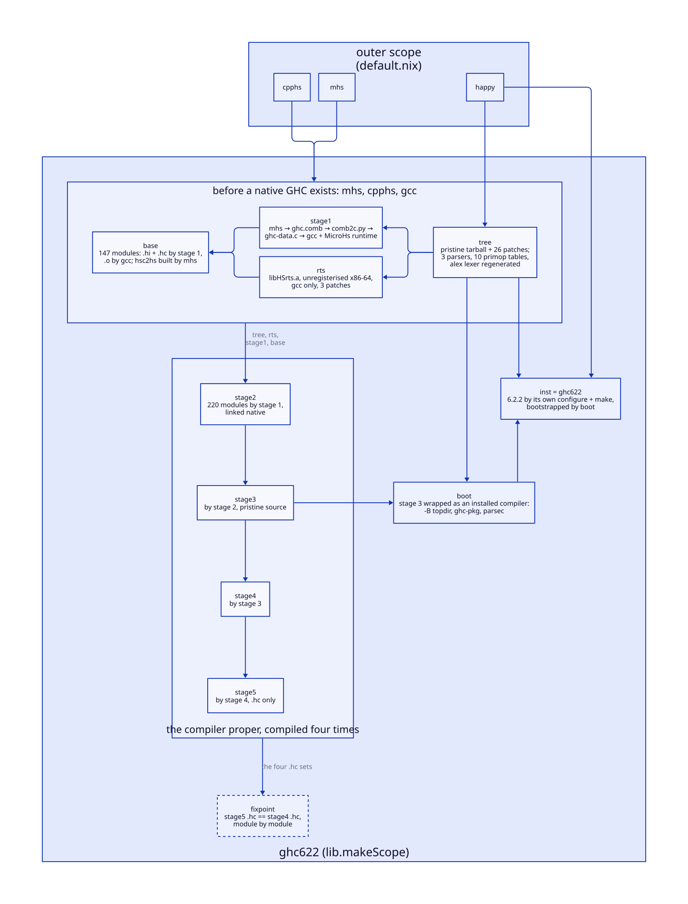
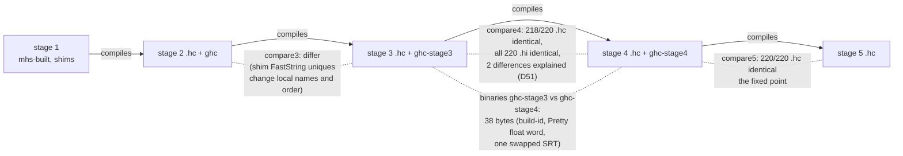
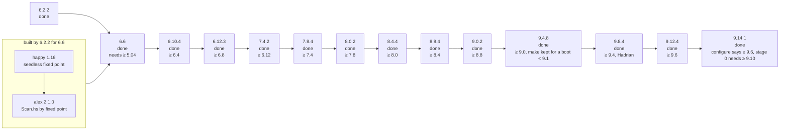

# The chain, drawn

Six views of the bootstrap chain, as Mermaid diagrams (GitHub renders them;
elsewhere, paste into any Mermaid viewer). Each is drawn from a file in this
repository, named above it, and re-read on 2026-10-01. [README.md](README.md) has the
prose; [DECISIONS.md](DECISIONS.md) has the reasons.

## 1. The whole chain, one link per compiler

From [README.md](README.md) and `default.nix`.

```mermaid
flowchart LR
    host["Host: C toolchain<br/>gcc, binutils, glibc, GMP<br/>sh, make, tar, perl, python3"]
    hugs["Hugs 98 (Sep 2006)<br/>patches 0002, 0003"]
    mhs["MicroHs (mhs)<br/>gen 1 interpreted by Hugs<br/>gen 2 == gen 3"]
    tools["cpphs, happy 1.19.5, hsc2hs<br/>compiled by mhs"]
    s1["GHC 6.2.2 stage 1<br/>compiler proper, run on<br/>the MicroHs runtime"]
    libs["rts, base, haskell98<br/>compiled by stage 1 + gcc"]
    s2["GHC 6.2.2 stage 2<br/>native"]
    s3["stage 3"]
    s4["stage 4"]
    s5["stage 5<br/>.hc only"]
    g66["GHC 6.6<br/>configure + make<br/>happy 1.16, alex 2.1.0"]
    g610["GHC 6.10.4 ... 9.14.1<br/>see section 6"]
    host --> hugs --> mhs --> tools --> s1 --> libs --> s2 --> s3 --> s4 --> s5
    s5 -. "220/220 .hc byte-identical" .-> s4
    s3 -->|"wrapped as boot;<br/>6.2.2's own make = ghc622"| g66 --> g610
```

## 2. Phase 0: the seed, Hugs to a self-hosting mhs

From `mhs/default.nix` and `mhs/bootstrap-seed.sh`. The Nix build deletes
MicroHs's shipped `generated/*.c` before anything runs; the `build/` scripts
use the shipped `mhs.c`, and [D1](DECISIONS.md#d1--the-seed-is-c-compiler--hugs-source-not-microhss-shipped-comb) is the check that the two compilers agree.

## 3. The mhs-built tools, each closed by a fixed point

From `cpphs/default.nix` and `happy/default.nix`.

## 4. GHC 6.2.2 as the Nix derivation graph

Edges are the inputs of each `ghc622/*.nix`; stdenv, python3, perl and
gmp are omitted, and an edge into a box stands for one into each derivation
in it. `ghc622/default.nix` says why there are this many steps. This
one is D2 with the TALA layout, not Mermaid: the source is
`diagrams/ghc622-derivations.d2`, and the render command is in its header.

## 5. What is compared with what

The `compare3`, `compare4` and `compare5` targets of `build/Makefile`, and
[ghc622/README.md](ghc622/README.md#what-does-not-work)'s "What does not work" item 1. `stageN/*.hc` is what the stage N-1
compiler emitted.

## 6. The road past 6.2.2

Every GHC below is built (`ghcNN/`, [DECISIONS.md](DECISIONS.md) [D52](DECISIONS.md#d52--622-builds-itself-with-its-own-build-system-the-chain-climbs-to-6123-gmp-62-breaks-every-ghc-before-80)-[D54](DECISIONS.md#d54--hadrian-rungs-984--9124--9141-one-derivation-for-all-three-the-chain-reaches-the-newest-release)). The floor
under each release is the minimum boot compiler its `configure.ac` accepts
(read 2026-10-01); it is configure's check only, and 9.14.1 showed it can
be stale: its configure says 9.6, its stage-0 build needs 9.10's
ghc-internal, so 9.12.4 is on the ladder.

