```mermaid
flowchart LR
    host["Host: C toolchain<br/>gcc, binutils, glibc, GMP<br/>sh, make, tar, perl, python3"]
    hugs["Hugs 98 (Sep 2006)<br/>patches 0002, 0003"]
    mhs["MicroHs (mhs)<br/>gen 1 interpreted by Hugs<br/>gen 2 == gen 3"]
    tools["cpphs, happy 1.19.5, hsc2hs<br/>compiled by mhs"]
    s1["GHC 6.2.2 stage 1<br/>compiler proper, run on<br/>the MicroHs runtime"]
    libs["rts, base, haskell98<br/>compiled by stage 1 + gcc"]
    s2["GHC 6.2.2 stage 2<br/>native"]
    s3["stage 3"]
    s4["stage 4"]
    s5["stage 5<br/>.hc only"]
    g66["GHC 6.6<br/>configure + make<br/>happy 1.16, alex 2.1.0"]
    g610["6.10.4"]
    g612["6.12.3<br/>registerised from here"]
    g74["7.4.2"]
    g78["7.8.4<br/>last on GMP 6.1.2"]
    g80["8.0.2"]
    g84["8.4.4"]
    g88["8.8.4<br/>GHCi + SMP from here"]
    g90["9.0.2"]
    g94["9.4.8<br/>last with make"]
    g98["9.8.4<br/>Hadrian from here"]
    g912["9.12.4"]
    g914["9.14.1<br/>newest release"]
    host --> hugs --> mhs --> tools --> s1 --> libs --> s2 --> s3 --> s4 --> s5
    s5 -. "220/220 .hc byte-identical" .-> s4
    s3 -->|"wrapped as boot;<br/>6.2.2's own make = ghc622"| g66 --> g610 --> g612 --> g74 --> g78 --> g80 --> g84 --> g88 --> g90 --> g94 --> g98 --> g912 --> g914
```

# Bootstrapping GHC from source

Building GHC from source without a Haskell compiler that did not itself come
out of the chain, starting from a C compiler and the source of Hugs.

"Bootstrapping" here is meant in the sense of
[bootstrappable.org](https://bootstrappable.org): every compiler in the chain
is built from source by tools that were themselves built from source, so
that the trusted base is a C toolchain and source code rather than an opaque
pre-built binary or generated code standing in for source. What the chain
still takes from the host is listed below. It is not the narrower sense of
porting GHC to a new platform, nor of rebuilding GHC with a GHC that someone
already has.

The chain, each link built from source by the link before it:

```
C compiler + Hugs source     (Hugs patched for pattern guards, hugs/patches)
   -> mhs                    (Hugs runs the MicroHs compiler, which emits C for itself)
   -> cpphs, happy, hsc2hs   (compiled by mhs; cpphs only in the Nix build, see below)
   -> ghc                    (GHC 6.2.2's compiler proper, compiled by mhs)
   -> .hc                    (Abstract C for base and a test program)
   -> gcc -> ld              (with 6.2.2's own RTS, unregisterised x86-64)
   -> an executable that runs and prints "hello"
```

What the chain takes from the host, stated precisely:

- **No Haskell implementation from outside the chain, and generated code
  standing in for source only where this list says, each item discharged
  or checked as stated** (the audit of 2026-10-12, D55):
  - **happy's parser, discharged.** The first portable happy parser was
    generated by a happy built with the machine's GHC 9.14. `happy-mhs` then
    regenerated it, and generation 3 is byte-identical to generation 2, so the
    GHC-built happy leaves the trusted base (D7, D14). That is a fixpoint,
    which is weaker than diverse double compilation.
  - **The `mhs` binary, checked.** The scripts under `build/` run
    `MicroHs/bin/mhs`, and that binary was compiled from MicroHs's shipped
    `generated/mhs.c` (step 4 of `mhs/bootstrap-seed.sh`), not from
    Hugs's output. MicroHs has the stronger check: compiling MicroHs, the
    Hugs-built compiler and the one built from the shipped seed emit
    byte-identical C (D1, rechecked 2026-09-30 against the Nix build). So
    the binary is equivalent to the Hugs-derived one as a compiler, but it is
    not that binary. The Nix build (`default.nix`) uses the Hugs-derived one,
    deletes MicroHs's `generated/*.c` before anything runs, and its check
    phase requires that the Hugs-derived `mhs`, run as MicroHs's Makefile
    runs it (`-z`), reproduces the shipped `generated/mhs.c` byte for byte
    (it does, for 0.16.8.0, 2026-10-12): the shipped seed is exactly what
    the source yields.
  - **cpphs, now checked.** `MicroHs/bin/cpphs`, which the `build/` scripts
    run, is MicroHs's shipped `generated/cpphs.c` compiled by gcc
    (`notes/phase2/FINDINGS.md`). mhs runs it on every module that uses CPP, which
    includes most of the GHC 6.2.2 sources stage 1 compiles. From stage 2 on,
    GHC's own `-cpp` uses gcc. The Nix build (`cpphs/default.nix`) builds cpphs
    from source with mhs instead: gcc's traditional cpp stands in for the
    first round, and rounds 2 and 3 reach a fixed point. The source-built
    cpphs and the shipped one give identical output on every `.hs`, `.lhs`
    and `.pp` file of GHC 6.2.2 with the chain's three flag sets (1,458
    runs), except for the source path in cpphs's own `#error` message.
  - **alex's own lexer, by fixed point.** alex 2.1.0 and 3.2.7.4
    (`ghc66/alex210.nix`, `ghc74/alex327.nix`) start
    from the `Scan.hs` their tarballs ship, which only an alex can make; the
    alex built from it must regenerate it from `Scan.x`, and a second
    generation must reproduce the first byte for byte. Their parsers are
    regenerated from `Parser.y` by the chain's happy. The alex 3.5.2.0 in
    9.12.4's Hadrian bootstrap plan is built from its shipped `Scan.hs`
    with no such check.
  - **happy 1.16, 1.19.5, 1.19.12 and 1.20.1.1**, built by the rungs that
    need them (6.2.2, 7.4.2, 8.8.4, 9.0.2), have their parsers regenerated
    from the grammars (the 1.19.12 and 1.20.1.1 tarballs ship none; they
    come from the release tags) by the chain's happy, compared with the
    shipped ones, and taken to a fixed point. 1.19.12's templates ship only
    preprocessed; they are remade from the tag's sources with the chain's
    cpphs, the way upstream's `gen-happy-sdist` makes them, and must be
    byte for byte the shipped ones. 1.19.5's templates are cpp'd by its
    `Setup.lhs`, whose line-marker regex leaves `stdc-predef.h` markers in
    them (and so in every parser it writes); they are redone with
    `ghc66/cpp-template.sh`.
  - **GHC 6.2.2's `parser/Lexer.hs`, used as shipped.** It is alex 2.0's
    output, which `convert-lexer.py` rewrites over boxed arrays; `Lexer.x` is
    in the tarball, but no alex exists before 6.2.2 is built. The three
    parsers and the primop tables of 6.2.2 are regenerated (happy-mhs,
    genprimopcode). Not checked.
  - **The parsers and lexers of every rung from 6.6 on, regenerated.** GHC's
    source tarballs ship every happy and alex output the build needs and,
    since 6.10, the grammars renamed `<name>.source` so that no build runs
    happy or alex; 6.6 ships the grammars under their names. 6.6's
    derivation deletes the seven shipped modules; from 6.10 on
    `common/regen-parsers.sh` moves the shipped modules aside and gives the
    grammars their names back, and the tarball's own build rules regenerate
    them with a chain-built happy and alex of a version its configure
    accepts: 6.6's 1.16 and 2.1.0 up to 7.4.2, 7.4.2's happy 1.19.5 for
    7.8.4 to 8.8.4, 8.8.4's 1.19.12 for 9.0.2, 9.0.2's 1.20.1.1 from 9.4.8,
    and 7.4.2's alex 3.2.7.4 for every rung from 7.8.4 on (no alex 3.1.x
    will do: their executable imports QuickCheck, which 7.4.2 has not).
    Cabal's lexer, alex output committed in Cabal's tree
    (8.4 to 9.8), is regenerated the same way. After the build
    `common/cmp-regenerated.sh` compares each regenerated module with the
    shipped one, strictly when the chain's happy is the version that made
    it (8.0.2 by 1.19.5, 9.0.2 by 1.19.12, 9.8.4 to 9.14.1 by 1.20.1.1),
    as a report otherwise.
- **A C toolchain**: gcc, binutils, glibc, and the system GMP, which is
  linked into every program.
- **Nothing pre-built from a tarball.** Two source tarballs carry build
  products: 7.4.2's `utils/ghc-pwd/dist-boot` (a `ghc-pwd` binary with its
  `.o` and `.hi`) and 9.0.2's `libraries/containers/.../dist-install`
  (objects, archives, a shared library; a dirty checkout at release time,
  reported in the 9.0.2 announcement thread). Neither was used (7.4.2's
  configure rebuilds `ghc-pwd`; the chain's `libHScontainers` differs from
  the shipped one), and both derivations now delete them before anything
  runs, as `mhs/default.nix` deletes MicroHs's `generated/*.c`.
- **`configure` scripts as the tarballs ship them.** Every `configure` the
  chain runs (GHC's, its libraries', GMP's, Hugs's) is autoconf output, and
  is run as shipped; the Hadrian rungs regenerate the libraries' ones, as
  Hadrian does. That is what Guix and nixpkgs do (Debian regenerates with
  `dh_autoreconf`); bootstrappable.org's best practices say nothing about
  it. Regenerating would mean taking each release's `configure.ac` and
  `m4/` from upstream's history with an autoconf of the right era, and
  would not by itself catch an xz-style payload, which rode in the
  tarball's `m4/`. We do not, and say so here.
- **Build tools** that run scripts in this repository: `sh`, `make`, `tar`,
  `perl` (one RTS fix-up script) and `python3`. Python does two jobs that
  put bytes into the compiler: `comb2c.py` writes mhs's combinator output
  for the stage-1 compiler as the C array `mhs -o ghc.c` would have
  written, and `convert-lexer.py` decodes the alex lexer's tables. It also
  generates the module order and dependencies and checks interfaces.

The first
attempt used GHC 4.08.2 as the compiler rung and stopped at a 64-bit runtime
bug (D42); 6.2.2 is the first GHC that knows x86-64 exists, and the same
chain goes all the way through with it (D45–D48).

The mhs-built GHC 6.2.2 then compiles its own source into a native
compiler, and that compiler rebuilds itself to a fixed point: stage 5's
Abstract C is byte-identical to stage 4's in all 220 modules (D49-D51,
`build/ghc622-stage2/LOG.md`). The whole 6.2.2 chain is one Makefile,
`build/Makefile`.

The same chain as a picture (DIAGRAMS.md has five more: the Hugs seed, the
mhs-built tools, the 6.2.2 derivation graph, the fixed-point comparisons,
and the road past 6.2.2):



## What works

**The whole ladder, 6.2.2 to 9.14.1** (DECISIONS.md D52-D54; every rung is
`nix-build -A ghcNN`, each built by the one before it, each the newest
release whose build accepts the previous rung as the boot compiler, each
passing `common/test/T3.hs` and the checks named in its derivation):

| Rung | Built by | Build system | What it needed on a 2026 host (gcc 15, glibc 2.42, binutils 2.46) |
|---|---|---|---|
| 6.2.2 (`ghc622`) | mhs, then itself to a fixed point | its own `configure && make` from stage 3 | RTS patches, `gen-htypes`, `_GNU_SOURCE`, a happy wrapper; GMP 6.1.2 (D52) |
| 6.6 | 6.2.2 | make | parsers regenerated with happy 1.16 and alex 2.1.0 built by 6.2.2 |
| 6.10.4, 6.12.3 | 6.6, 6.10.4 | make | plain `ar` for libffi; `__GNUC__ > 4` blocks in Rts.h; registerised + NCG from 6.12 |
| 7.4.2, 7.8.4 | 6.12.3, 7.4.2 | make | `-std=gnu89 -fpermissive -fwrapv`; `DYNAMIC_* = NO`; GMP 6.1.2 |
| 8.0.2, 8.4.4 | 7.8.4, 8.0.2 | make -j | `-std=gnu11`; threaded RTS way for iserv; `CC=gcc` (8.4); host GMP from here |
| 8.8.4, 9.0.2 | 8.4.4, 8.8.4 | make -j | `GHC=`; GHCi and SMP (8.8 does not compile without GHCi); StgCRunAsm patch; `--with-gmp-*` (9.0) |
| 9.4.8 | 9.0.2 | make -j (9.4 keeps make for a boot < 9.1) | happy 1.20.1.1 and alex 3.2.7.4 built by 9.0.2 for `build-tool-depends`; python3 |
| 9.8.4 | 9.4.8 | Hadrian, bootstrapped by `bootstrap.py` from a plan with Nix-fetched sources | hp2ps C23 patch (upstream, in 9.10) |
| 9.12.4 | 9.8.4 | Hadrian | nothing beyond the plan |
| 9.14.1 | 9.12.4 (its configure says 9.6, stage 0 needs 9.10) | Hadrian | the ghc-9.14 branch's `Binary HalfWord` guard |

9.14.1 is the newest GHC release at the time of writing. The compilers from
8.8 on are the standard configuration: registerised, native code generator,
GHCi, SMP, static libraries; a `-threaded` program they compile links
outside Nix and takes `-N`.

**GHC 6.2.2 in detail** (see DECISIONS.md D45-D51,
`build/ghc622-mhs/FINDINGS.md`, `FINDINGS-link.md` and
`build/ghc622-stage2/LOG.md`):

| Stage | Result |
|---|---|
| 6.2.2's compiler proper, typechecked by mhs | 226/235 modules, `Main` included |
| ... linked by mhs + gcc | a 2.9MB `ghc` that answers `-B<topdir> --version` |
| `libraries/base` compiled by it | 147/147 modules to `.hi` + `.hc` |
| those `.hc` compiled by gcc | 147/147 `.o` (`-fwrapv` is mandatory) |
| `ghc/rts` unregisterised x86-64 | 78/78 objects, `libHSrts.a` |
| base cbits, `libHSbase.a` | built, no patches |
| `hsc2hs`, built with mhs | builds after 17 changed lines in a copy of its `Main.hs` (the `Parser` instances; `build/hsc2hs-mhs/FINDINGS.md`), not in the `ghc622/patches` series |
| Link of a Haskell program | zero undefined symbols |
| **Run** | **`putStrLn "hello"` prints and exits 0**; 12 programs (GC, Integer, Double, I/O, exceptions, `forkIO`, arrays, time/dir/random/regex) build and pass, rechecked 2026-09-23 against the current base and RTS |
| `libraries/haskell98` compiled by it | 30/30 to `.o`, `libHShaskell98.a` |
| **Stage 2**: 6.2.2's compiler proper compiled by the mhs-built `ghc` | 220/220 modules, linked as `build/ghc622-stage2/ghc`, compiles `Hello.hs` |
| **Stage 3**: the same 220 modules compiled by stage 2, pristine source | 220/220, linked as `ghc-stage3`; its `Hello.hc` equals stage 2's |
| **Stage 4**: compiled by `ghc-stage3` | 218 of 220 `.hc` identical to stage 3, all 220 `.hi` identical; the 2 differences are explained (D51) |
| **Stage 5**: compiled by `ghc-stage4` | **220/220 `.hc` byte-identical to stage 4: the fixed point** |

**GHC 4.08.2** (the first chain, DECISIONS.md D1-D42; retired, kept as the
record of why the entry point moved):

| Stage | Result |
|---|---|
| `hsc`, GHC 4.08.2's compiler proper | builds and runs (2.2MB) |
| `ghc/lib/std` — the Prelude | 45/45 modules to object code |
| `hslibs/lang` | 24/24 modules to object code |
| `ghc/rts` — the runtime | 52/52 (45 C + 7 hand-written Abstract C) |
| `cbits` | 42/42 |
| Link | 6MB executable |
| **Run** | **`main = return ()` runs and exits 0** |

On 4.08.2 a program that does I/O does not work: it reaches the buffering
setup for `stdout` and dies on a 64-bit assumption in the 1999 runtime
(D42). That is the bug 6.2.2 does not have.

## Reproducing

Sources are pristine tarballs plus patches — nothing is edited in place, and the
invariant is checked, not assumed.

### With Nix

The whole chain is in `default.nix`, one attribute per link, each built by
the one before it:

```sh
nix-build -A ghc914              # Hugs -> mhs -> GHC 6.2.2 -> ... -> GHC 9.14.1
nix-build -A ghc622.fixpoint     # GHC 6.2.2 through stage 5, checks the fixed point
```

`default.nix` pins nixpkgs; every other input is a tarball or commit listed
in `SOURCES.md`, plus the patches in this repository. The rest of this
section is the same chain without Nix, as it was first built.

The scripts under `build/` and `notes/` find the checkout through
`GHC_BOOTSTRAP_ROOT`, which `mise.toml` sets to the repository root. Run them
under mise (`mise activate` in the shell, or `mise exec -- sh build/...`);
without it they stop at once with `GHC_BOOTSTRAP_ROOT: not set`. The scripts
in the link directories (`hugs/`, `mhs/`, `ghc622/`) find the repository from
their own location and need nothing.

### GHC 6.2.2, the current entry point (D45–D48)

The compiler tree, from the pristine `ghc-6.2.2-src.tar.bz2`:

```sh
sh ghc622/reproduce-6.2.2.sh            # -> build/repro-622/ghc, 3-4 minutes
```

One script: 26 patches (`ghc622/patches`, one concern each), GHC's own
configure and `config.h` rule, `DerivedConstants.h` from
`mkDerivedConstants.c` with the unregisterised flags, the `HTYPE_*` block
that gcc 16 stops configure from producing, the three parsers and ten primop
tables regenerated with our happy and an mhs-built genprimopcode, and the
alex lexer's `Addr#` tables decoded into boxed arrays. The result is checked
against the working tree with `diff -r`: identical up to the tabs in
`config.h`'s 28-line prologue and, since this machine's kernel headers
started defining `EFTYPE` on 2026-09-10, one probed value, `CONST_EFTYPE`
(rerun 2026-09-23, `notes/phase4/FINDINGS.md` section 3). The series is derived from the working tree,
not the other way round: `sh ghc622/make-patch.sh` regenerates it and fails
on any hunk it cannot classify. `notes/phase4/FINDINGS.md` records the provenance
of every input, including the ones the script does not produce (the shims,
the boot files, `Config.hs`).

Typechecking the tree with mhs (about an hour; `notes/phase4/FINDINGS.md` section 2):

```sh
TMPDIR=build/repro-622/tmp EXTRA_SHIMS=$PWD/ghc622/shims \
  sh ghc622/tools/probe-ordered.sh <label> build/repro-622/ghc/compiler \
     build/repro-622/ghc/includes build/repro-622/order-6.2.2.txt \
     ghc622/hsboot build/repro-622/gen
```

From the typechecked tree to the self-hosting compiler, the chain is one
dependency graph, `build/Makefile` (it sets `GHC_BOOTSTRAP_ROOT` itself;
the header lists every target):

```sh
make -f build/Makefile -j4 test3            # stage 1, base, haskell98, stages 2 and 3
make -f build/Makefile -j4 stage5           # stages 4 and 5
make -f build/Makefile compare4 compare5    # the fixed-point checks
make -f build/Makefile status               # what is stale, one line per phase
```

`-j4` because each GHC compile may use up to 8 GB of address space.
`make -j4 test` took 58 minutes wall on 2026-09-16 (16 cores); queue it
where it outlives the terminal. The Makefile reads, but does not build:
the compiler tree `build/ghc-6.2.2-run1` (what `reproduce-6.2.2.sh`
reproduces), the RTS (`build/rts622/libHSrts.a`, from `build-rts.sh`:
three patches, 78 objects), base's C objects (`build/ghc622-mhs/cbitsobj`,
from `build-cbits.sh`), and the modules of base that `hsc2hs` generates
(with our mhs-built `hsc2hs`, `build/hsc2hs-mhs`). To compile, link and
run one program with the stage-1 compiler:
`mise exec -- sh build/ghc622-mhs/link.sh build/ghc622-mhs/test/Hello.hs`.

### GHC 4.08.2 (retired chain, D1–D42)

The first route, retired when the 1999 runtime proved unfixable on x86-64
(D42), is recorded in `notes/phase2` and `notes/phase3`: its 30 patches,
build scripts and findings.

## Layout

```
DECISIONS.md          the decision log, D1-D55: every choice and every wrong turn
BOOTSTRAP-ANALYSIS.md why this chain, and why not a shorter one (2026-09-02, with status notes)
PATCHES.md            the two patch series, grouped by what each patch is really about
DIAGRAMS.md, diagrams/ the chain as six diagrams (Mermaid, and D2 for the derivation graph): links, seed, tools, derivation graph, comparisons, road ahead
default.nix           the chain as Nix derivations, one directory per link:
                      nix-build -A hugs|mhs|cpphs|happy|gmp612|ghc622|ghc66|ghc610|ghc612|ghc74|ghc78|ghc80|ghc84|ghc88|ghc90|ghc94|ghc98|ghc912|ghc914
hugs/ mhs/ cpphs/ happy/ gmp612/
ghc622/ ghc66/ ... ghc914/
                      each link's derivation (default.nix) and every file it reads:
                      patches, shims, boot files, build tables, test programs;
                      ghc66/, ghc74/, ghc88/ and ghc94/ hold steps (ghc66.happy116, ghc74.alex327, ...).
                      The same links without Nix: hugs/build-hugs.sh,
                      mhs/bootstrap-seed.sh (with the check against MicroHs's shipped C),
                      ghc622/reproduce-6.2.2.sh
  ghc622/             GHC 6.2.2, the entry point since D45: default.nix and the steps
                      in nix/ (ghc622.tree, .stage1, .stage2, ...); patches/ (the series
                      0001-0026, generated from series.conf by make-patch.sh), shims/
                      shims-ghc/ shims-h98/, hsboot/, gen/, tools/, and the inputs of
                      each stage (stage1/, base/, stage2/, rts/, hsc2hs/, test/);
                      generated files (Config.hs, the module orders, fixups,
                      package.conf) are made by tools/ in the build
common/               what several links share: shims/ (ghc-on-mhs, used by happy and
                      6.2.2), test/ (T3, GmpZero), hadrian-ghc.nix (the Hadrian rungs)
notes/                how the chain was found, kept as evidence (DECISIONS.md cites it):
  phase0/             surveying candidate compilers (feature-scan.py); the seed findings
  phase1/             ghc-on-mhs: import inventory, happy analysis
  phase2/             the 4.08.2 compiler (hsc): patches 0001-0024, hs-boot sets for
                      4.08.2 and 6.0, cpp pipeline
  phase3/             the 4.08.2 libraries and runtime: patches 0019-0030, build steps
  phase4/             FINDINGS.md: the 6.2.2 reproduction and the provenance of every
                      non-patch input
build/                the manual 6.2.2 work tree (Makefile, scripts, results), and outputs:
  Makefile            the 6.2.2 chain from stage 1 to stage 5, one dependency graph
  mk/                 its per-module recipes and the generated dependency rules
  ghc-6.2.2-run1/     the compiler tree mhs typechecks (the reference reproduce-6.2.2.sh diffs against)
  gen622/ lexer622/   regenerated parsers and primop tables; the alex lexer conversion
  rts622/             6.2.2's RTS on x86-64, libHSrts.a
  ghc622-mhs/         the mhs-built ghc, base, cbits, libHSbase.a, link.sh, the 12 test programs
  hsc2hs-mhs/         hsc2hs built with mhs
  ghc622-stage2/      stages 2-5: the native compilers, their objects and results, LOG.md
  repro-622/          the output of reproduce-6.2.2.sh
  rebase622/ research-6.2-x86_64.md   the measurements behind D45
```

## What does not work, precisely

On the 6.2.2 chain, as of 2026-09-23:

1. **The fixed point is exact for the Abstract C, not for the binaries.**
   `ghc-stage3` and `ghc-stage4` differ in 38 bytes: the GNU build-id note,
   and two objects. `utils/Pretty` has an uninitialised upper word in a
   `Float` literal (`PprAbsC.floatToWord` reads a 4-byte float back as an
   8-byte word, a 6.2.2 defect on 64-bit). `coreSyn/CoreUtils` has one SRT
   with two entries swapped, because Unique order follows evaluation order,
   and stage 1 compiled 25 modules with `-fno-strictness`. Neither leak
   propagates: stage 5 equals stage 4 in all 220 `.hc` files (D51;
   `make -f build/Makefile compare4 compare5`, rerun 2026-09-23). The
   `floatToWord` defect is left unpatched in the pristine stage-2 source.
2. **The reproduction depends on the host's headers.** `reproduce-6.2.2.sh`
   applies all 26 patches exactly, but on this machine it now writes
   `CONST_EFTYPE 134` where the reference tree has `-1`, because
   kernel-headers 7.2.4 (installed 2026-09-10) define `EFTYPE`
   (`notes/phase4/FINDINGS.md` section 3).
3. **Nine compiler modules do not typecheck under mhs**, none on `Main`'s
   path (the probe of D46): `PrimPacked` (shadowed by the FastString shim),
   five GHCi bytecode modules plus `InteractiveUI` (`GHC.Ptr`; GHCI is off),
   and the dead `IlxGen` and `JavaGen` back ends.
4. **Known 6.2.2 limits on x86-64** (`build/research-6.2-x86_64.md`):
   `foreign import "wrapper"` adjustors are not supported. 6.2.2's
   `HEAP_ALLOCED` keyed a 4096-entry map on the low 32 bits of an address;
   under ASLR the heap aliased static data in about 0.6% of processes, and
   the GC then treated static closures as heap objects. RTS patch 0003 replaces it
   with a fixed heap base and a 64 GB window, so a program's heap cannot
   grow past 64 GB (D50).
5. **Hygiene.** The RTS is compiled without `-fwrapv` (no failure traced to
   it). The 4.08.2 `hsc` was never relinked with the fixed FastString shim.
   Three shim modules (`FastString`, `Foreign`, `StringBuffer`) exist both
   in `ghc622/shims-ghc` (the 4.08.2 set) and in `ghc622/shims`,
   with different contents; the 6.2.2 build puts the second directory first
   on the `-i` path.

The 4.08.2 chain stopped at D42: GHC 4.08.2 targets 32-bit machines and has
no entry for x86-64 at all, so wherever "32-bit" and "correct" happened to
coincide the code is silently wrong and nothing selects a working
alternative. Six such bugs were fixed (D30, D31, D36, D42); the seventh,
execution jumping into `PrelHandle_getBModezuzu_info` instead of its entry
code, is where it was left. Finishing it would be a port of the 1999 runtime
to a word size it was never written for, which is why the entry point moved.

## The thing most worth knowing

`hsc` is not a compiler you can invoke. It is the middle of a pipeline whose two
ends were written in perl, and eight separate responsibilities had to be
reconstructed before it would produce a working library:

1. `unlit` — literate Haskell, dispatched on the `.lhs` suffix
2. cpp, with the driver's exact five `-D` flags
3. `ghc-iface.lprl` — `hsc` writes only a *partial* interface
4. the shipped `PrelGHC.hi` — the primop interface is not compiled
5. `-fsimplify [ -fmax-simplifier-iterations4 ]` — never omitted, even at `-O0`
6. `{-# OPTIONS #-}` extraction — `hsc` does not read pragmas
7. `-package-name std` — which the driver *renames* to `-inpackage=std`
8. `-static` — without it the code generator emits `DLL_SRT_ENTRY`, a macro
   defined as text that cannot compile

Three of the eight are invisible from `hsc`'s own flag list. The rule that came
out of it: when something is missing, read `ghc.lprl` before concluding anything
about GHC being broken. It held for 6.2.2 too: `hsc2hs`'s flags, the 32 `-u`
symbols on the link line, `-fwrapv` and `-std=gnu89` all came from reading
the Makefiles and `DriverPipeline`, not from the compiler's own help text.
