# Bootstrapping GHC from source

This repository builds GHC 9.14.1, the latest release at the time of writing,
starting from a C compiler and the source code of Hugs. Every compiler in the
chain is built from source by the one before it. There is no Haskell binary
to trust, and generated code stands in for source only in the few places I
list in [What the chain trusts](#what-the-chain-trusts).

By "bootstrapping" I mean what [bootstrappable.org](https://bootstrappable.org)
means: the trusted base is a C toolchain and source code, not a pre-built
binary. "Bootstrapping GHC with Hugs" is on their
[list of projects](https://bootstrappable.org/projects.html). This is not about porting
GHC to a new platform, nor about rebuilding GHC with a GHC you already have.

I relied on Claude (Anthropic's coding agent) for most of the grunt work:
running the probes, chasing build failures, writing patches and Nix
derivations, and keeping the notes. Every choice and every wrong turn is in
[`DECISIONS.md`](DECISIONS.md), written as we went.

## TL;DR

```sh
nix-build -A ghc914              # Hugs -> MicroHs -> GHC 6.2.2 -> ... -> GHC 9.14.1
nix-build -A ghc622.fixpoint     # GHC 6.2.2 up to stage 5, and the fixed-point check
```

Every link is an attribute of `default.nix` (`hugs`, `mhs`, `cpphs`, `happy`,
`gmp612`, `ghc622`, `ghc66`, ... `ghc914`). nixpkgs is pinned, and every other
input is a tarball or commit fetched by hash and listed in [`SOURCES.md`](SOURCES.md). I have
only built it on x86-64 Linux.

## How I found the route

Every GHC needs an older GHC; today's master asks for 9.10. If you follow the
chain back you end up at GHC 0.29 (1996), built with HBC, which is written in
LML. Some old GHC tarballs ship generated C, but generated code is not source:
starting from it just moves the binary seed somewhere less visible.

When I started, four approaches were on the table
([Breitner 748](https://www.joachim-breitner.de/blog/748-Thoughts_on_bootstrapping_GHC),
[Breitner 802](https://www.joachim-breitner.de/blog/802-More_thoughts_on_a_bootstrappable_GHC),
[Wurmus 2017](https://elephly.net/posts/2017-01-09-bootstrapping-haskell-part-1.html),
[the Discourse thread](https://discourse.haskell.org/t/what-s-needed-to-bootstrap-ghc-with-hugs/6205)):

1. **Walk the historical chain.** Dead at the root: HBC needs LML, and 1990s
   code does not build with 2020s toolchains. Guix has the upper part, from a
   4.08.2 built from the tarball's generated C, with a gap around 6.12 and 7.x.
2. **Hugs -> nhc98 -> early GHC** (Wurmus, 2017). Stalled: nhc98 is 32-bit
   only, and nobody showed it could build any GHC.
3. **Run GHC's own source under Hugs** (Breitner, 802). Hugs cannot do
   mutually recursive modules, so Breitner flattened GHC into a single
   680,000-line module. What was left: GHC's compiler reaches into RTS
   internals through `base`, primops and unboxed types, the FFI, and Hugs only
   speaks Haskell 98.
4. **Write a new bootstrappable compiler.** In 2017 nobody was going to. Since
   then somebody did, for other reasons: [MicroHs](https://microhs.org/).

MicroHs is the missing seed. It is maintained and self-hosting, it compiles via
combinators to C, and it reads `.hs-boot` files, so mutual recursion is not a
problem. It even has a path that runs its own compiler under Hugs. That path
had rotted: it died on pattern guards, which Hugs never implemented. I added
pattern guards to Hugs rather than rewriting MicroHs's source ([D18](DECISIONS.md#d18--upstream-microhs-chose-the-other-fix-for-the-hugs-problem)), and that
gave a seed of a C compiler and Hugs source only. The Hugs-built MicroHs
reproduces MicroHs's own shipped C byte for byte ([D1](DECISIONS.md#d1--the-seed-is-c-compiler--hugs-source-not-microhss-shipped-comb)).

The plan I wrote on 2026-09-02 had phases 0 to 4 (the plan as first written is
[`BOOTSTRAP-ANALYSIS.md`](https://github.com/andreabedini/ghc-bootstrap/blob/7638183f08baa3d7a99f719c6abf7855b7f04335/BOOTSTRAP-ANALYSIS.md)
in the git history). This is what became of them:

| Phase | Plan | Outcome |
|---|---|---|
| 0 | verify the Hugs -> MicroHs seed | done, once Hugs had pattern guards ([`notes/phase0/FINDINGS.md`](notes/phase0/FINDINGS.md)) |
| 1 | pick the target GHC by measuring, not by assuming | 4.08.2 scored best ([D2](DECISIONS.md#d2--target-ghc-4082-on-measurement-rather-than-on-the-guix-argument)). Later I concluded 6.x was out of reach ([D44](DECISIONS.md#d44--is-ghc-6x-within-mhss-reach-measured-not-estimated)) and I was wrong: it was one macro, `SLIT` ([D45](DECISIONS.md#d45--d44-overturned-the-entry-point-moves-to-ghc-622)) |
| 2 | a ghc-on-mhs shim layer plus a patch series over pristine tarballs | done for both 4.08.2 and 6.2.2; flattening GHC turned out to be unnecessary |
| 3 | run the old GHC under mhs and close the loop to a native, self-hosting GHC | impossible on 4.08.2, whose 1999 runtime has 64-bit bugs ([D42](DECISIONS.md#d42--where-it-stands-64-bit-assumptions-in-a-1999-runtime)); done on 6.2.2 ([D47](DECISIONS.md#d47--the-compiler-links-runs-and-compiles-base-137143-modules-to-hc)-[D51](DECISIONS.md#d51--stage-3-and-stage-4-the-native-compiler-rebuilds-itself-218-of-220-modules-byte-identical)) |
| 4 | fill Guix's gap from 6.10.4 to 7.8.4 | done, and carried on to 9.14.1 ([D52](DECISIONS.md#d52--622-builds-itself-with-its-own-build-system-the-chain-climbs-to-6123-gmp-62-breaks-every-ghc-before-80)-[D54](DECISIONS.md#d54--hadrian-builds-984--9124--9141-one-derivation-for-all-three-the-chain-reaches-the-newest-release)) |

The first chain used GHC 4.08.2. Its runtime has no x86-64 port, and I gave up
on it at the seventh 64-bit bug; [notes/](notes/README.md) keeps that chain
and its patches. GHC 6.2.2 is the first release with an x86-64 port
(unregisterised, via C), and with it the same approach goes all the way
through.

I considered one fallback, jeffstyr's idea from the Discourse thread, and did
not need it: have a modern GHC emit a dictionary-passing, Core-derived
rendering of itself and compile that with mhs. It would buy some trust through diverse double compilation, but it is
not a bootstrap.

## The chain

```mermaid
flowchart LR
    host["Host: C toolchain<br/>gcc, binutils, glibc, GMP<br/>sh, make, tar, perl, python3"]
    hugs["Hugs 98 (Sep 2006)<br/>patches 0002, 0003"]
    mhs["MicroHs (mhs)<br/>gen 1 interpreted by Hugs<br/>gen 2 == gen 3"]
    tools["cpphs, happy 1.19.5, hsc2hs<br/>compiled by mhs"]
    s1["GHC 6.2.2 stage 1<br/>compiler proper, run on<br/>the MicroHs runtime"]
    libs["rts, base, haskell98<br/>compiled by stage 1 + gcc"]
    s2["GHC 6.2.2 stage 2<br/>native"]
    s3["stage 3"]
    s4["stage 4"]
    s5["stage 5<br/>.hc only"]
    g66["GHC 6.6<br/>configure + make<br/>happy 1.16, alex 2.1.0"]
    g610["6.10.4"]
    g612["6.12.3<br/>registerised from here"]
    g74["7.4.2"]
    g78["7.8.4<br/>last on GMP 6.1.2"]
    g80["8.0.2"]
    g84["8.4.4"]
    g88["8.8.4<br/>GHCi + SMP from here"]
    g90["9.0.2"]
    g94["9.4.8<br/>last with make"]
    g98["9.8.4<br/>Hadrian from here"]
    g912["9.12.4"]
    g914["9.14.1<br/>newest release"]
    host --> hugs --> mhs --> tools --> s1 --> libs --> s2 --> s3 --> s4 --> s5
    s5 -. "220/220 .hc byte-identical" .-> s4
    s3 -->|"wrapped as boot;<br/>6.2.2's own make = ghc622"| g66 --> g610 --> g612 --> g74 --> g78 --> g80 --> g84 --> g88 --> g90 --> g94 --> g98 --> g912 --> g914
```



Each link has its own directory, with the derivation, every file it reads, and
a README:

| Link | Built by | Build system | What it needed on a 2026 host (gcc 15, glibc 2.42, binutils 2.46) |
|---|---|---|---|
| [Hugs 98](hugs/README.md) | gcc | configure, make | pattern guards; permissive C flags in `CC` |
| [MicroHs 0.16.8.0](mhs/README.md) | Hugs, then itself | | generation 3 equals generation 2; the shipped C is deleted |
| [cpphs 1.20.9](cpphs/README.md) | mhs | three rounds, from gcc's cpp to a fixed point | |
| [happy 1.19.5](happy/README.md) | mhs | | its own parsers, by fixed point and by diverse double compilation from happy 1.15 |
| [GMP 6.1.2](gmp612/README.md) | gcc | configure, make | for every GHC before 8.0 ([D52](DECISIONS.md#d52--622-builds-itself-with-its-own-build-system-the-chain-climbs-to-6123-gmp-62-breaks-every-ghc-before-80)) |
| [GHC 6.2.2](ghc622/README.md) | mhs, then itself to a fixed point | by hand up to stage 3, then its own `configure && make` | 26 patches for mhs; RTS patches, `gen-htypes`, `_GNU_SOURCE`, a happy wrapper |
| [GHC 6.6](ghc66/README.md) | 6.2.2 | make | parsers regenerated with happy 1.16 and alex 2.1.0 built by 6.2.2 |
| [GHC 6.10.4](ghc610/README.md), [6.12.3](ghc612/README.md) | 6.6, 6.10.4 | make | plain `ar` for libffi; `__GNUC__ > 4` blocks in `Rts.h`; registerised with NCG from 6.12 |
| [GHC 7.4.2](ghc74/README.md), [7.8.4](ghc78/README.md) | 6.12.3, 7.4.2 | make | `-std=gnu89 -fpermissive -fwrapv`; `DYNAMIC_* = NO`; happy 1.19.5 and alex 3.2.7.4 built by 7.4.2 |
| [GHC 8.0.2](ghc80/README.md), [8.4.4](ghc84/README.md) | 7.8.4, 8.0.2 | make -j | `-std=gnu11`; `CC=gcc` (8.4); the host's GMP from here |
| [GHC 8.8.4](ghc88/README.md), [9.0.2](ghc90/README.md) | 8.4.4, 8.8.4 | make -j | `GHC=`; GHCi and SMP; StgCRunAsm patch; `--with-gmp-*` (9.0) |
| [GHC 9.4.8](ghc94/README.md) | 9.0.2 | make -j (9.4 keeps make for a boot < 9.1) | happy 1.20.1.1 built by 9.0.2 for `build-tool-depends`; python3 |
| [GHC 9.8.4](ghc98/README.md) | 9.4.8 | Hadrian, bootstrapped by `bootstrap.py` from a plan with Nix-fetched sources | hp2ps C23 patch (upstream, in 9.10) |
| [GHC 9.12.4](ghc912/README.md) | 9.8.4 | Hadrian | nothing beyond the plan |
| [GHC 9.14.1](ghc914/README.md) | 9.12.4 (its configure says 9.6, stage 0 needs 9.10) | Hadrian | the ghc-9.14 branch's `Binary HalfWord` guard |

Each GHC is the newest release that accepts the previous one as its boot
compiler. Each one passes `common/test/T3.hs` and whatever checks its
derivation names ([D52](DECISIONS.md#d52--622-builds-itself-with-its-own-build-system-the-chain-climbs-to-6123-gmp-62-breaks-every-ghc-before-80)-[D54](DECISIONS.md#d54--hadrian-builds-984--9124--9141-one-derivation-for-all-three-the-chain-reaches-the-newest-release)). From 8.8 on the compilers have the standard
configuration: registerised, native code generator, GHCi, SMP, static
libraries. A `-threaded` program they compile links outside Nix and runs with
`-N`.

GHC 6.2.2 is the step that matters. mhs compiles its compiler proper, that
compiler builds 6.2.2's runtime and libraries, and then it compiles its own
source. By stage 5 the Abstract C is byte-identical to stage 4's in all 220
modules ([D49](DECISIONS.md#d49--stage-2-begun-the-mhs-built-ghc-compiles-its-own-source-interrupted)-[D51](DECISIONS.md#d51--stage-3-and-stage-4-the-native-compiler-rebuilds-itself-218-of-220-modules-byte-identical)). The [ghc622 README](ghc622/README.md) has the stages, the
patch series and what still does not work.

## What the chain trusts

bootstrappable.org explains the [benefits](https://bootstrappable.org/benefits.html)
as provenance: the dependency graph shows how every binary was obtained. And
its [best practices](https://bootstrappable.org/best-practices.html) ask a
self-hosted compiler to stay buildable by a different implementation of its
language. No other Haskell implementation can build today's GHC, so Hugs and
MicroHs play that role here, by way of GHC 6.2.2. This is the full list of what the chain still takes on trust:

- **No Haskell implementation from outside the chain.** Generated code stands
  in for source only where this list says, and I discharged or checked each
  case (the audit of 2026-10-12, [D55](DECISIONS.md#d55--generated-code-in-the-inputs-the-audit-and-the-parsers-and-lexers-of-610-to-914-regenerated-from-their-grammars)):
  - **happy's parser, discharged.** The first portable happy parser came out
    of a happy built with my machine's GHC 9.14. `happy-mhs` then regenerated
    it, and generation 3 is byte-identical to generation 2, so the GHC-built
    happy leaves the trusted base ([D7](DECISIONS.md#d7--use-the-machines-ghc-9141-as-a-one-time-generator-then-discharge-it), [D14](DECISIONS.md#d14--verify-happy-by-generation-not-by-equality-with-happy-ghc)). A fixed point
    alone would be weaker than [diverse double compilation](https://dwheeler.com/trusting-trust/),
    so I also start from an unrelated seed: the parser happy 1.14 wrote, which
    happy's repository commits at the `Happy_1_15` tag. happy 1.15 built from
    it, by way of a happy 1.19.5, gives the same seed byte for byte
    (`nix-build -A happy.ddc115`, [D56](DECISIONS.md#d56--happys-seed-by-diverse-double-compilation-from-happy-115);
    the idea and the patch for 1.15 are Alexandre Tunstall's, [#2](https://github.com/andreabedini/ghc-bootstrap/issues/2)).
  - **MicroHs's shipped C, checked.** The Nix build deletes MicroHs's
    `generated/*.c` before anything runs. Its check phase then requires the
    Hugs-derived `mhs`, run as MicroHs's Makefile runs it (`-z`), to reproduce
    the shipped `generated/mhs.c` byte for byte. It does, for 0.16.8.0
    (2026-10-12): the shipped seed is exactly what the source yields. The
    scripts under `build/` run `MicroHs/bin/mhs`, compiled from that shipped C.
    As a compiler it is equivalent to the Hugs-derived one, but it is not the
    same binary ([D1](DECISIONS.md#d1--the-seed-is-c-compiler--hugs-source-not-microhss-shipped-comb)).
  - **cpphs, checked.** The Nix build builds cpphs from source with mhs, with
    gcc's traditional cpp standing in for the first round. The source-built
    cpphs and MicroHs's shipped one give identical output on every `.hs`,
    `.lhs` and `.pp` file of GHC 6.2.2 with the chain's three flag sets (1,458
    runs). The `build/` scripts run the shipped one. From 6.2.2's stage 2 on,
    GHC's own `-cpp` uses gcc.
  - **alex's own lexer, by fixed point.** alex 2.1.0 and 3.2.7.4 start from
    the `Scan.hs` their tarballs ship, which only an alex can produce. The alex
    built from it has to regenerate it from `Scan.x`, and a second generation
    has to reproduce the first byte for byte. The alex 3.5.2.0 in Hadrian's
    bootstrap plan is built from its shipped `Scan.hs` without that check.
  - **happy 1.16, 1.19.5, 1.19.12 and 1.20.1.1**, built by the GHCs that need
    them, have their parsers regenerated from the grammars by the chain's
    happy, compared with the shipped ones, and taken to a fixed point.
  - **GHC 6.2.2's `parser/Lexer.hs`, used as shipped.** It is alex 2.0's
    output, which `convert-lexer.py` rewrites over boxed arrays. `Lexer.x` is
    in the tarball, but no alex exists before 6.2.2 is built. I have not
    checked this one. 6.2.2's three parsers and its primop tables are
    regenerated.
  - **The parsers and lexers of every GHC from 6.6 on, regenerated.** GHC's
    tarballs ship every happy and alex output the build needs. From 6.10 on,
    `common/regen-parsers.sh` gives the grammars their names back, so the
    tarball's own rules regenerate them with a happy and alex from the chain.
    Cabal's lexer (8.4 to 9.8) is regenerated the same way, and
    `common/cmp-regenerated.sh` compares each result with the shipped file.
- **A C toolchain**: gcc, binutils, glibc, and the system GMP, which is linked
  into every program.
- **Nothing pre-built from a tarball.** Two source tarballs carry build
  products: 7.4.2's `utils/ghc-pwd/dist-boot` and 9.0.2's
  `libraries/containers/.../dist-install`. Neither is used, and both
  derivations delete them before anything runs.
- **`configure` scripts as the tarballs ship them.** Every `configure` the
  chain runs (GHC's, its libraries', GMP's, Hugs's) is autoconf output, run as
  shipped. The Hadrian builds (9.8.4 on) regenerate the libraries' ones, as Hadrian does.
  Guix and nixpkgs do the same, while Debian regenerates with
  `dh_autoreconf`. bootstrappable.org's best practices say nothing about it.
  Regenerating would mean taking each release's `configure.ac` and `m4/` from
  upstream's history and running an autoconf of the right era. Even that would
  not catch an xz-style payload on its own, since that one rode in the
  tarball's `m4/`. I don't regenerate them.
- **Build tools** that run the scripts in this repository: `sh`, `make`, `tar`,
  `perl` (one RTS fix-up script) and `python3`. Python puts bytes into the
  compiler in two places:
  - `comb2c.py` writes mhs's combinator output for the stage-1 compiler as the
    C array `mhs -o ghc.c` would have written;
  - `convert-lexer.py` decodes the alex lexer's tables.

  It also generates the module order and dependencies, and checks interfaces.

## Repository layout

| Path | What it is |
|---|---|
| `default.nix` | the chain as Nix derivations, one attribute per link |
| [`hugs/`](hugs/README.md), [`mhs/`](mhs/README.md), [`cpphs/`](cpphs/README.md), [`happy/`](happy/README.md), [`gmp612/`](gmp612/README.md) | the seed and its tools |
| [`ghc622/`](ghc622/README.md) | GHC 6.2.2, the entry point: the stages, the patch series, the shims |
| [`ghc66/`](ghc66/README.md) ... [`ghc914/`](ghc914/README.md) | one directory per GHC release, each with its derivation and every file it reads |
| [`common/`](common/README.md) | what several links share: the ghc-on-mhs shims, the parser regeneration, the Hadrian build, the test programs |
| [`build/`](build/README.md) | the 6.2.2 chain as I first built it by hand, before Nix: scripts, findings, results |
| [`notes/`](notes/README.md) | how the chain was found, phase by phase, including the retired GHC 4.08.2 chain |
| [`DECISIONS.md`](DECISIONS.md) | the decision log, [D1](DECISIONS.md#d1--the-seed-is-c-compiler--hugs-source-not-microhss-shipped-comb)-[D55](DECISIONS.md#d55--generated-code-in-the-inputs-the-audit-and-the-parsers-and-lexers-of-610-to-914-regenerated-from-their-grammars): every choice and every wrong turn |
| [`DIAGRAMS.md`](DIAGRAMS.md), `diagrams/` | the chain as six diagrams |
| [`SOURCES.md`](SOURCES.md) | where every input comes from, with hashes |
| `mise.toml` | sets `GHC_BOOTSTRAP_ROOT` for the scripts in `build/` and `notes/` |
| `LICENSE` | BSD 3-Clause, for what I wrote; see [Licence](#licence) for the patches |

## Licence

What I wrote here (the scripts, Nix expressions, shims, findings and
documentation) is under the BSD 3-Clause licence in `LICENSE`.

The patches, and the few files copied or generated from an upstream source,
are derived from that project and stay under its licence:

| Upstream | Licence | Files here |
|---|---|---|
| GHC | the Glasgow Haskell Compiler License (BSD-style) | `ghc622/patches/`, `ghc622/rts/patches/`, `ghc622/hsc2hs/Main.hs.patch`, `ghc622/stage2/fixups/parser/Ctype.lhs.patch`, `ghc622/tools/genprimopcode-Main.hs.patch`, `build/ghc622-mhs/diag/faststring-intern.patch`, `ghc66/`, `ghc90/`, `ghc98/` and `ghc914/` `*.patch`, `notes/phase2/patches/`, `notes/phase3/patches/`; `Language/Haskell/THSyntax.hs` in `ghc622/shims/` and `build/shims-6.0-run2/`; the Hadrian plans `plan-bootstrap-*.json` in `ghc98/`, `ghc912/` and `ghc914/` |
| Hugs 98 | the Hugs 98 licence (BSD-style) | `hugs/patches/` |
| MicroHs | Apache License 2.0 | `mhs/patches/` |
| happy | the Happy licence (BSD-style) | `happy/happy-seed/` (generated by happy from happy 1.19.5's grammars), `happy/ddc115/happy-1.15-mhs.patch` (Alexandre Tunstall's, from issue #2) |
| cpphs | LGPL 2.1 (library), GPL 2 (program) | `cpphs/cpphs-1.20.9-mhs.patch` |
| polyparse | LGPL 2.1 | `cpphs/polyparse-1.12-mhs.patch` |

`ghc90/StgCRunAsm-only-when-needed.patch` and `ghc98/hp2ps-C-gnu17.patch` are
upstream GHC changes by the authors named in their headers. The upstream
sources themselves are not in this repository; [`SOURCES.md`](SOURCES.md) says where each
one comes from.
